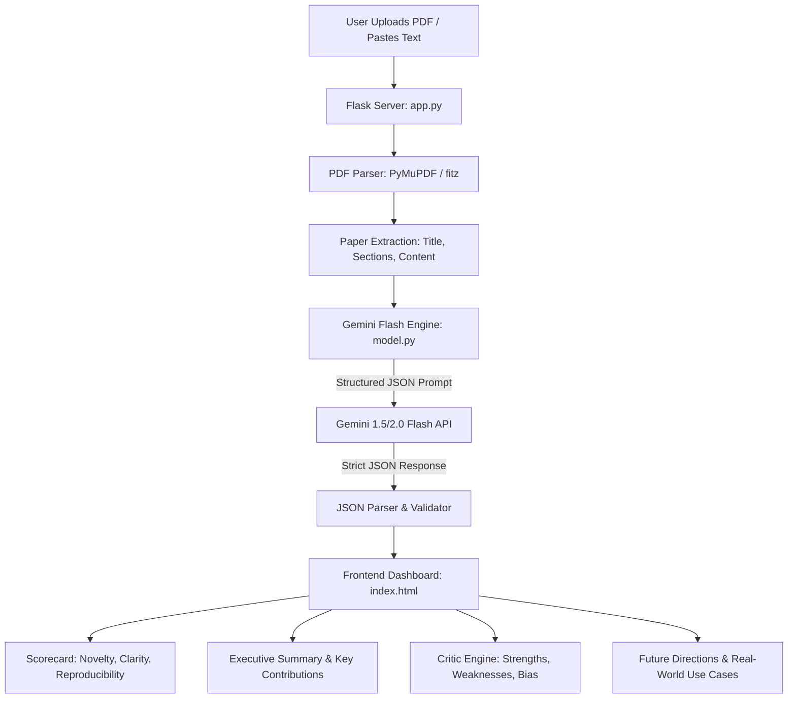

# 🚀 Implementation Plan: Autonomous Research Paper Summarizer + Critic

Transforming **ScholarSummarizer** into an autonomous research paper summarizer and critical reviewer powered by **Google Gemini API (Free Tier)**.

---

## 🏗️ Architectural Overview

---

## 📅 Roadmap & Execution Phases

### Phase 1: Environment & API Setup
- [x] **Step 1.1**: Obtain a free Google Gemini API key from [Google AI Studio](https://aistudio.google.com/).
- [x] **Step 1.2**: Update [requirements.txt](file:///c:/testing/ScholarSummarizer/requirements.txt) with modern, lightweight dependencies:
  - `google-genai==2.33.0`
  - `pymupdf==1.28.2`
  - `flask==3.1.3`
  - `python-dotenv==1.2.4`
  - `gunicorn==27.0.1`
- [x] **Step 1.3**: Configure `.env` file with `GEMINI_API_KEY` and verify API connectivity (Verified working with `gemini-3.5-flash`).

---

### Phase 2: PDF Parsing Engine
- [x] **Step 2.1**: Implement [parser.py](file:///c:/testing/ScholarSummarizer/parser.py) using `pymupdf`:
  - Extract text cleanly from multi-column academic PDF layouts.
  - Detect core sections: Title, Abstract, Methodology, Experiments/Results, Conclusion.
  - Handle edge cases (zero pages, corrupted files, non-text scanned pages via `is_scanned` flag).
  - Verified with automated test suite in [test_parser.py](file:///c:/testing/ScholarSummarizer/test_parser.py).

---

### Phase 3: Core AI Engine & Critic Logic (`model.py`)
- [x] **Step 3.1**: Initialize the Gemini client using `gemini-3.5-flash` with automatic fallback.
- [x] **Step 3.2**: Design a structured system prompt using Gemini's native `response_mime_type="application/json"` schema.
- [x] **Step 3.3**: Configure the output structure to include:
  1. **Metadata**: Title, authors, domain.
  2. **Summarization**:
     - 1-sentence TL;DR.
     - 3-5 Key Contributions.
     - Section breakdowns (Problem Statement, Methods, Findings).
  3. **Critic Engine (The Core USP)**:
     - Strengths (methodological soundness, clarity, novelty).
     - Weaknesses & Limitations.
     - Dataset & Experimental Evaluation (size adequacy, potential bias, overfitting risk).
  4. **Paper Scoring Matrix (1 to 5 Stars + Rationale)**:
     - **Novelty**: Originality of the proposed solution.
     - **Clarity**: Structure, explanation, and visual communication.
     - **Reproducibility**: Availability of code, hyperparameters, and dataset clarity.
  5. **Future Work Generator**:
     - Next research questions to explore.
     - Practical industrial/real-world applications.
  - Verified with live peer-review generation in [test_critic.py](file:///c:/testing/ScholarSummarizer/test_critic.py).

---

### Phase 4: Flask Interactive Dashboard (`app.py` & `templates/index.html`)
- [x] **Step 4.1**: Build interactive Flask application with modern UI & 10MB upload limit:
  - Client-side & server-side enforcement of **10MB maximum file size**.
  - Immediate reminder/alert banner if a user selects a file $> 10\text{ MB}$.
  - Drag-and-drop PDF dropzone (`Limit 10MB per file • PDF`) + raw text fallback.
- [x] **Step 4.2**: Render interactive scorecard metrics:
  - Visual star / score indicators for **Novelty**, **Clarity**, **Reproducibility**, and **Overall Verdict**.
- [x] **Step 4.3**: Implement tabbed evaluation panels:
  - 📑 **Summary & Contributions Tab**: TL;DR, key contributions, problem statement & methodology overview.
  - ⚖️ **Critic Report Tab**: Strengths, weaknesses, dataset sufficiency, potential bias, and validation rigor.
  - 💡 **Future Directions Tab**: Actionable research improvements, alternative paradigms, and industry use cases.
- [x] **Step 4.4**: Implement report export functionality (One-click Download Review as Markdown / JSON).

---

### Phase 5: Verification & Portfolio Polish
- [x] **Step 5.1**: Test with standard academic research papers:
  - Automated integration test in [test_e2e.py](file:///c:/testing/ScholarSummarizer/test_e2e.py) validating the complete workflow (PDF upload $\rightarrow$ PyMuPDF parsing $\rightarrow$ Gemini Critic review $\rightarrow$ Markdown report download).
- [x] **Step 5.2**: Update [README.md](file:///c:/testing/ScholarSummarizer/README.md) with Streamlit launch commands, feature showcase, architecture diagrams, and portfolio documentation.
