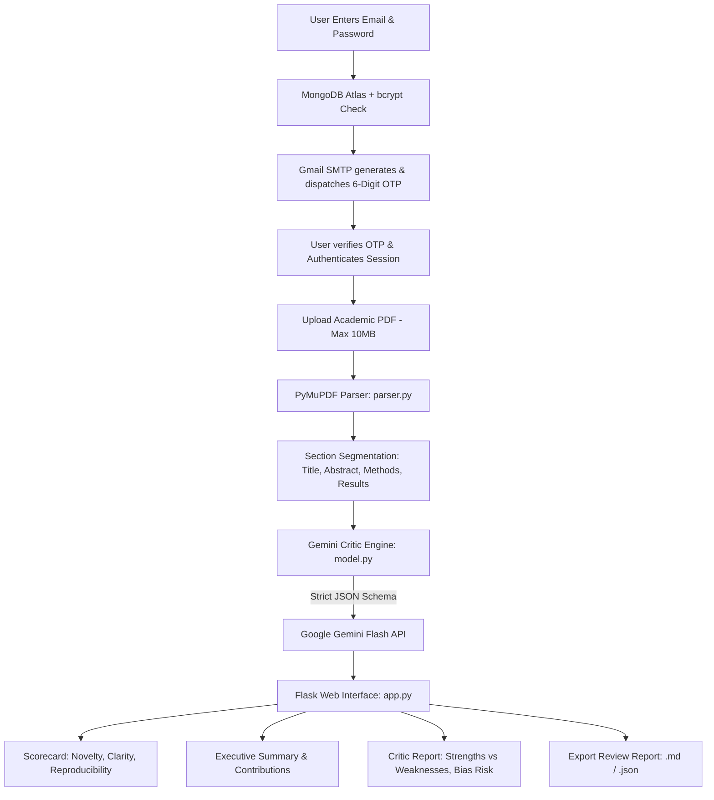

# 📚 ScholarCritic: Autonomous Research Paper Summarizer + Critic

> **Goes beyond basic summarization:** An autonomous academic research paper analysis and peer-review system that reads academic PDFs, extracts core methodology, critically evaluates scientific rigor, generates calibrated star scorecards, and proposes future research directions.

[](https://python.org)
[](https://flask.palletsprojects.com/)
[](https://www.mongodb.com/atlas)
[](https://aistudio.google.com)
[](https://pymupdf.readthedocs.io/)
[](LICENSE)

---

## 🌟 Why This Project Stands Out

Most summarizers simply shorten text. **ScholarCritic** functions as an **AI Peer Reviewer** for researchers, students, and startups:
- 🔐 **Secure 2-Factor Authentication:** Account registration with MongoDB Atlas storage, bcrypt password hashing, and real-time 6-digit numeric OTP sent via Gmail SMTP.
- 📖 **Smart Paper Ingestion:** Multi-column academic PDF parsing using `PyMuPDF` with automatic section extraction (`Abstract`, `Methodology`, `Results`, `Conclusion`). Enforces strict 10MB limit.
- 🧠 **Structured Summarization:** Generates an executive TL;DR, 3–5 core scientific contributions, and section breakdowns.
- ⚖️ **Research Critic Engine (Core USP):** Pinpoints technical strengths vs. critical limitations, flags dataset insufficiency, evaluates benchmark overfitting/leakage, and assesses methodology novelty.
- 🏆 **Paper Scoring System:** Calibrated 1–5 star ratings across **Novelty**, **Clarity**, and **Reproducibility**, with an overall acceptance verdict.
- 💡 **Future Work Generator:** Actionable research extensions, alternative paradigms, and real-world industrial applications.
- 🎨 **Editorial Glassmorphic UI:** Modern layout inspired by editorial design systems (60% Cream, 30% Navy, 10% Coral palette) with seamless dark mode support.
- 📥 **Export Reports:** One-click download of peer-review reports in **Markdown (`.md`)** and **JSON (`.json`)**.

---

## 🏗️ System Architecture



---

## 🛠️ Tech Stack

- **Backend:** [Flask](https://flask.palletsprojects.com/)
- **Database & Auth:** [MongoDB Atlas](https://www.mongodb.com/atlas) with `pymongo` & `bcrypt`
- **Email Delivery:** Python `smtplib` via Gmail SMTP (App Password OTP verification)
- **Document & PDF Parser:** [PyMuPDF](https://pymupdf.readthedocs.io/)
- **AI & Peer Review Engine:** Google Gemini Flash (`gemini-3.5-flash` via `google-genai` SDK)
- **Frontend & Styling:** HTML5, CSS3 Glassmorphism, Vanilla JS, Google Fonts (Plus Jakarta Sans & Space Grotesk)

---

## 🚀 Quick Start Guide

### 1. Clone the repository
```bash
git clone https://github.com/Nababrato2003/Scholar_Summarizer.git
cd Scholar_Summarizer
```

### 2. Install dependencies
```bash
pip install -r requirements.txt
```

### 3. Configure `.env`
Create a `.env` file in the project root (or copy from `.env.example`):
```env
# Google Gemini API Key (https://aistudio.google.com/)
GEMINI_API_KEY=your_gemini_api_key_here

# MongoDB Atlas URI (https://www.mongodb.com/atlas)
MONGO_URI=mongodb+srv://<username>:<password>@cluster0.xxxxx.mongodb.net/?retryWrites=true&w=majority

# Gmail SMTP Configuration
MAIL_SERVER=smtp.gmail.com
MAIL_PORT=587
MAIL_USERNAME=your_gmail_address@gmail.com
MAIL_PASSWORD=your_16_character_app_password
```

### 4. Launch the Application
```bash
python app.py
```
Open your browser at `http://127.0.0.1:5000`.

---

## 📂 Project Structure

```
Scholar_Summarizer/
├── app.py                   # Flask server, route controllers, session handling
├── auth.py                  # MongoDB Atlas client, bcrypt hashing, Gmail SMTP OTP engine
├── model.py                 # Gemini Critic Engine with structured JSON schema
├── parser.py                # Academic PDF parsing & section segmentation (PyMuPDF)
├── requirements.txt         # Lightweight production dependencies
├── templates/
│   └── index.html           # Modern glassmorphic landing page + Auth Modal
├── static/
│   └── style.css            # 60-30-10 Cream/Navy/Coral styling + Dark Mode
├── sample_papers/           # Open-access test arXiv papers
├── .env.example             # Template for required environment variables
├── vercel.json              # Vercel deployment configuration
├── Procfile                 # Cloud deployment entry point
├── test_parser.py           # Unit tests for PDF parser
├── test_critic.py           # Verification for Critic Engine & scoring
└── test_e2e.py              # End-to-end integration test
```

---

## 📄 License
This project is licensed under the MIT License - see the [LICENSE](LICENSE) file for details.
