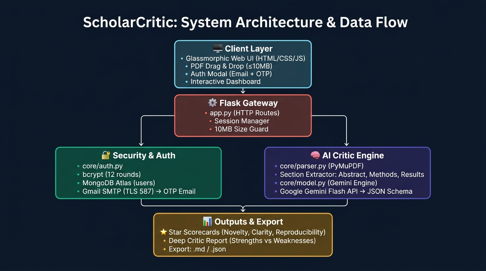
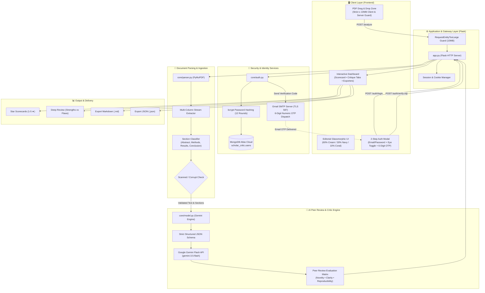

# 📚 ScholarCritic: Autonomous Research Paper Summarizer + Critic

> **Beyond Simple Summarization:** An autonomous academic research paper analysis and peer-review system that ingests academic PDFs, extracts core methodology, critically evaluates scientific rigor, generates calibrated star scorecards, and proposes future research directions.

[](https://python.org)
[](https://flask.palletsprojects.com/)
[](https://www.mongodb.com/atlas)
[](https://aistudio.google.com)
[](https://pymupdf.readthedocs.io/)
[](LICENSE)

---

## 🌟 Why This Project Stands Out

Most summarizers simply condense text into bullet points. **ScholarCritic** functions as an **Autonomous AI Peer Reviewer** for researchers, students, and startups:

- 🔐 **2-Factor Authentication:** Account registration with MongoDB Atlas storage, `bcrypt` password hashing, and real-time 6-digit numeric OTP sent via Gmail SMTP with an interactive password eye toggle.
- 📖 **Smart Academic PDF Parsing:** Multi-column academic extraction using `PyMuPDF` with automatic section segmentation (`Abstract`, `Methodology`, `Results`, `Conclusion`). Enforces strict 10MB limits with real-time UI warnings.
- 🧠 **Structured Summarization:** Generates an executive TL;DR, 3–5 core scientific contributions, and section breakdowns.
- ⚖️ **Research Critic Engine (Core USP):** Pinpoints technical strengths vs. critical limitations, flags dataset insufficiency, evaluates benchmark overfitting/leakage, and assesses methodology novelty.
- 🏆 **Paper Scoring Matrix:** Calibrated 1–5 star ratings across **Novelty**, **Clarity**, and **Reproducibility**, with an overall acceptance verdict.
- 💡 **Future Work Generator:** Actionable research extensions, alternative paradigms, and real-world industrial applications.
- 🎨 **Editorial Glassmorphic UI:** Ultra-modern layout inspired by editorial design systems (60% Cream, 30% Navy, 10% Coral palette) with dark mode preservation.
- 📥 **Export Reports:** One-click download of peer-review reports in **Markdown (`.md`)** and **JSON (`.json`)**.

---

## 🏗️ System Architecture



<details>
<summary>📐 View as interactive Mermaid flowchart</summary>



</details>

---

## 📊 Traditional Summarizers vs. ScholarCritic

| Feature | Generic Summarizer (BART / ChatGPT) | ScholarCritic |
| :--- | :--- | :--- |
| **PDF Ingestion** | Raw flat text copy-paste | Multi-column PyMuPDF extraction with layout awareness |
| **Section Segmentation** | ❌ None (Treats text as one block) | ✅ Automatically identifies Methods, Results, Conclusion |
| **Critical Review** | ❌ Superficial bullet points | ✅ In-depth Critique (Identifies dataset flaws, bias, leakage) |
| **Objective Scoring** | ❌ Arbitrary or none | ✅ Calibrated 1–5 Star Matrix (Novelty, Clarity, Reproducibility) |
| **Future Direction Suggestions** | ❌ Generic advice | ✅ Actionable research extensions & industrial applications |
| **Authentication & Security** | ❌ None | ✅ MongoDB Atlas + bcrypt + Gmail SMTP 6-Digit OTP |
| **Export Formats** | ❌ None or plain copy | ✅ One-click export in structured Markdown (`.md`) & JSON (`.json`) |

---

## 🏆 Paper Evaluation Rubric

ScholarCritic grades academic papers across three core criteria using a 1 to 5 star rating scale:

| Metric | 1–2 Stars (Low) | 3 Stars (Moderate) | 4–5 Stars (High) |
| :--- | :--- | :--- | :--- |
| **Novelty** | Incremental parameter tuning or trivial adaptation of existing models. | Novel application of existing architecture to a moderately new domain. | Breakthrough architecture, foundational theoretical proof, or new paradigm. |
| **Clarity** | Poorly structured, ambiguous terminology, missing baseline comparisons. | Generally understandable but lacks detailed parameter explanations or diagrams. | Exceptional exposition, intuitive diagrams, comprehensive mathematical proofs. |
| **Reproducibility** | No code/dataset provided, zero hyperparameter disclosure, unverified metrics. | Partial training details; code or benchmark available with minor ambiguities. | Open-source code, public dataset links, full ablation tables, reproducible seed list. |

---

## 🛠️ Tech Stack & Dependencies

- **Backend:** [Flask](https://flask.palletsprojects.com/) (Python 3.10+)
- **Database & Identity:** [MongoDB Atlas](https://www.mongodb.com/atlas) with `pymongo` & `bcrypt`
- **Email Delivery:** Python `smtplib` via Gmail SMTP (`smtp.gmail.com:587`)
- **Document & PDF Parser:** [PyMuPDF](https://pymupdf.readthedocs.io/)
- **AI & Peer Review Engine:** Google Gemini Flash (`gemini-3.5-flash` via `google-genai` SDK)
- **Frontend & Styling:** HTML5, CSS3 Glassmorphism, Vanilla JS, FontAwesome 6, Google Fonts

---

## 🚀 Quick Start Guide

### 1. Clone the repository
```bash
git clone https://github.com/Nababrato2003/Scholar_Summarizer.git
cd Scholar_Summarizer
```

### 2. Install dependencies
```bash
pip install -r requirements.txt
```

### 3. Launch the Application
```bash
python app.py
```
Open your browser at **`http://127.0.0.1:5000`**.

---

## 🔌 API Reference

| Endpoint | Method | Auth Required | Description |
| :--- | :--- | :--- | :--- |
| `/` | `GET` | No | Renders the main glassmorphic application dashboard. |
| `/auth/status` | `GET` | No | Returns the current user's session authentication state. |
| `/auth/login` | `POST` | No | Validates credentials (or registers new user) and sends 6-digit email OTP. |
| `/auth/verify-otp` | `POST` | No | Verifies 6-digit OTP code and establishes authenticated user session. |
| `/auth/resend-otp` | `POST` | No | Resends a fresh 6-digit OTP to the pending user's email. |
| `/auth/logout` | `POST` | Yes | Clears session cookie and logs out the current user. |
| `/analyze` | `POST` | **Yes** | Ingests PDF file (or raw text), parses layout, and generates Gemini critique. |
| `/export` | `POST` | No | Downloads the critique report as a formatted Markdown (`.md`) file. |

---

## 📂 Project Structure

```
Scholar_Summarizer/
├── app.py                      # Flask application entry point & route controllers
│
├── core/                       # Core engine & backend services
│   ├── __init__.py
│   ├── parser.py               # Academic PDF parsing & section extraction (PyMuPDF)
│   ├── model.py                # Gemini Flash Critic Engine & peer scoring
│   └── auth.py                 # MongoDB Atlas + Gmail SMTP 2FA OTP engine
│
├── tests/                      # Automated unit & integration tests
│   ├── __init__.py
│   ├── test_parser.py          # PDF parser verification
│   ├── test_critic.py          # Gemini Critic Engine tests
│   └── test_e2e.py             # End-to-end integration test
│
├── docs/                       # Project documentation & planning
│   └── IMPLEMENTATION_PLAN.md  # Architectural roadmap & milestone tracker
│
├── templates/
│   └── index.html              # Glassmorphic UI dashboard + Auth modal
│
├── static/
│   └── style.css               # Styling, 60-30-10 palette & dark mode
│
├── sample_papers/              # Example arXiv test papers
├── requirements.txt            # Python dependencies
├── vercel.json                 # Vercel deployment configuration
├── Procfile                    # Cloud WSGI deployment command
├── .env.example                # Template for environment variables
├── FUTURE_SCOPE.md             # Technical roadmap & edge case watchlist
└── README.md                   # Project documentation
```

---

## 🔭 Future Scope & Known Limitations

Detailed technical roadmap, upcoming feature milestones (arXiv link ingestion, audio summaries, interactive paper Q&A), and currently tracked edge cases are documented in **[FUTURE_SCOPE.md](FUTURE_SCOPE.md)**.

---

## 🔒 Security & Privacy

- **Zero PDF Storage:** Uploaded research paper PDFs are parsed entirely in memory and never stored persistently on the disk or shared with third parties.
- **Credential Protection:** Passwords are never saved in plain text; they are hashed using `bcrypt` with 12 salt rounds before storing in MongoDB Atlas.
- **Expiring OTPs:** Email 2-factor authentication codes expire strictly after 10 minutes and are cleared immediately upon successful verification.
- **Git Safety:** Sensitive API keys and SMTP credentials in `.env` are strictly excluded from version control via `.gitignore`.

---

## 📄 License
This project is licensed under the MIT License - see the [LICENSE](LICENSE) file for details.
