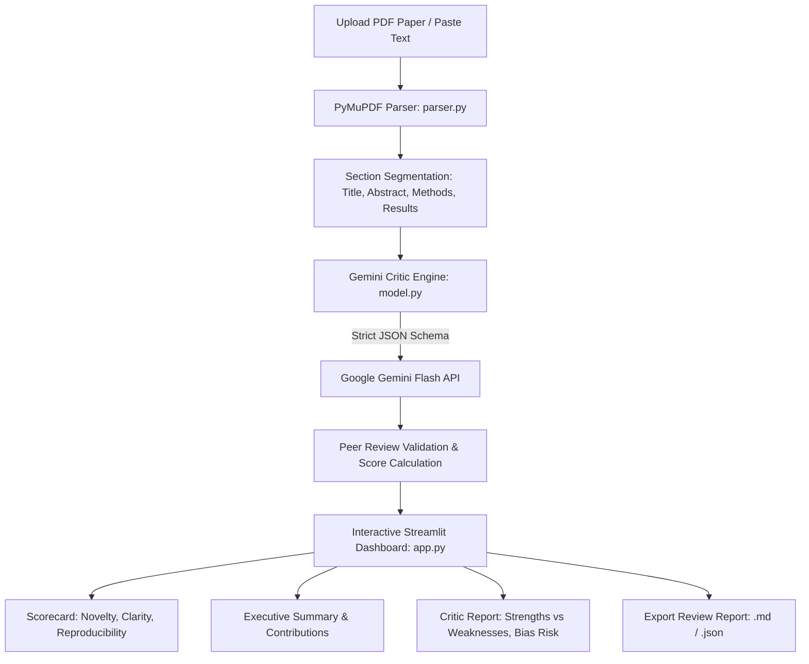

# 📚 ScholarCritic: Autonomous Research Paper Summarizer + Critic

> **Goes beyond basic summarization:** An autonomous research paper analysis and peer-review system that reads academic PDFs, extracts core methodology, critically evaluates scientific rigor, generates star scorecards, and proposes future research directions.

[](https://python.org)
[](https://streamlit.io)
[](https://aistudio.google.com)
[](https://pymupdf.readthedocs.io/)
[](LICENSE)

---

## 🌟 Why This Project Stands Out

Most summarizers simply shorten text. **ScholarCritic** functions as an **AI Peer Reviewer** for researchers, students, and startups:
- 📖 **Smart Paper Ingestion:** Multi-column academic PDF parsing using `PyMuPDF` with automatic section extraction (`Abstract`, `Methodology`, `Results`, `Conclusion`).
- 🧠 **Structured Summarization:** Generates an executive TL;DR, 3–5 core scientific contributions, and section breakdowns.
- ⚖️ **Research Critic Engine (Core USP):** Pinpoints technical strengths vs. critical limitations, flags dataset insufficiency, evaluates benchmark overfitting/leakage, and assesses methodology novelty.
- 🏆 **Paper Scoring System:** Calibrated 1–5 star ratings across **Novelty**, **Clarity**, and **Reproducibility**, with an overall acceptance verdict.
- 💡 **Future Work Generator:** Actionable research extensions, alternative paradigms, and real-world industrial applications.
- 📥 **Export Reports:** One-click download of peer-review reports in **Markdown (`.md`)** and **JSON (`.json`)**.

---

## 🏗️ System Architecture



---

## 🛠️ Tech Stack

- **Frontend & Dashboard:** [Streamlit](https://streamlit.io/)
- **Document & PDF Parser:** [PyMuPDF](https://pymupdf.readthedocs.io/)
- **AI & Peer Review Engine:** Google Gemini Flash (`gemini-3.5-flash` via `google-genai` SDK)
- **Environment & Config:** `python-dotenv`

---

## 🚀 Quick Start Guide

### 1. Clone the repository
```bash
git clone https://github.com/your-username/ScholarSummarizer.git
cd ScholarSummarizer
```

### 2. Install dependencies
```bash
pip install -r requirements.txt
```

### 3. Get your Free Gemini API Key
1. Visit [Google AI Studio](https://aistudio.google.com/).
2. Click **Get API key** $\rightarrow$ **Create API key** (free, no credit card required).
3. Create a `.env` file in the project root:
```env
GEMINI_API_KEY=your_gemini_api_key_here
```

### 4. Launch the Flask App
```bash
python app.py
```
Then open your browser at `http://127.0.0.1:5000`.

---

## 📂 Project Structure

```
ScholarSummarizer/
├── app.py                   # Streamlit interactive dashboard & report generator
├── model.py                 # Gemini Critic Engine with structured JSON schema
├── parser.py                # Academic PDF parsing & section segmentation (PyMuPDF)
├── requirements.txt         # Lightweight dependencies
├── Procfile                 # Cloud deployment entry point
├── IMPLEMENTATION_PLAN.md   # Architectural roadmap & milestone tracker
├── test_parser.py           # Unit tests for PDF parser
├── test_critic.py           # Verification for Critic Engine & scoring
└── test_e2e.py              # End-to-end integration test
```

---

## 📄 License
This project is licensed under the MIT License - see the [LICENSE](LICENSE) file for details.
