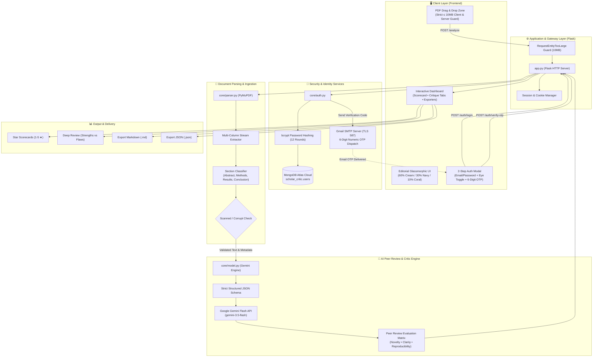

# 🚀 Implementation Plan: Autonomous Research Paper Summarizer + Critic

Transforming **ScholarCritic** into a publication-grade autonomous academic paper summarizer and critical peer reviewer powered by **Google Gemini Flash (Free Tier)**, **PyMuPDF**, and **MongoDB Atlas 2FA Authentication**.

---

## 🏗️ Architectural Overview

---

## 📅 Roadmap & Execution Phases

### Phase 1: Environment & API Setup
- [x] **Step 1.1**: Obtain a free Google Gemini API key from [Google AI Studio](https://aistudio.google.com/).
- [x] **Step 1.2**: Update [requirements.txt](file:///c:/testing/ScholarSummarizer/requirements.txt) with modern, lightweight dependencies:
  - `google-genai==2.33.0`
  - `pymupdf==1.28.2`
  - `flask==3.1.3`
  - `python-dotenv==1.2.4`
  - `gunicorn==27.0.1`
  - `pymongo==4.18.3`
  - `bcrypt==5.0.0`
  - `dnspython==2.8.0`
- [x] **Step 1.3**: Configure `.env` file with `GEMINI_API_KEY` and verify API connectivity (Verified working with `gemini-3.5-flash`).

---

### Phase 2: PDF Parsing Engine (`core/parser.py`)
- [x] **Step 2.1**: Implement multi-column text extraction using `pymupdf`.
- [x] **Step 2.2**: Automatic section detection (`Abstract`, `Methodology`, `Results`, `Conclusion`).
- [x] **Step 2.3**: Scanned PDF detection (`is_scanned` flag) to alert users if OCR is needed.
- [x] **Step 2.4**: Automated test suite in [tests/test_parser.py](file:///c:/testing/ScholarSummarizer/tests/test_parser.py).

---

### Phase 3: Core AI Engine & Critic Logic (`core/model.py`)
- [x] **Step 3.1**: Initialize Google Gemini client with primary `gemini-3.5-flash` and automatic fallback to `gemini-3.8-flash`.
- [x] **Step 3.2**: Strict JSON schema enforcement (`response_mime_type="application/json"`).
- [x] **Step 3.3**: Comprehensive peer-review schema:
  - 1-sentence TL;DR + 3-5 core scientific contributions.
  - Section breakdowns (Problem Statement, Methods, Findings).
  - Technical strengths vs. critical limitations.
  - Dataset sufficiency, sampling bias, data leakage, and overfitting risks.
  - 1–5 Star Rating Matrix for **Novelty**, **Clarity**, **Reproducibility**, and **Overall Verdict**.
  - Future research extensions & practical real-world applications.
- [x] **Step 3.4**: Automated test suite in [tests/test_critic.py](file:///c:/testing/ScholarSummarizer/tests/test_critic.py).

---

### Phase 4: Flask Interactive Dashboard (`app.py` & `templates/index.html`)
- [x] **Step 4.1**: Build interactive Flask application with modern UI & 10MB upload limit:
  - Client-side & server-side enforcement of **10MB maximum file size** (`MAX_CONTENT_LENGTH = 10 * 1024 * 1024`).
  - Drag-and-drop PDF dropzone (`Limit 10MB per file • PDF`).
- [x] **Step 4.2**: Render interactive scorecard metrics:
  - Visual star/score indicators for **Novelty**, **Clarity**, **Reproducibility**, and **Overall Verdict**.
- [x] **Step 4.3**: Implement tabbed evaluation panels:
  - 📑 **Summary & Contributions Tab**: TL;DR, key contributions, problem statement & methodology overview.
  - ⚖️ **Critic Report Tab**: Strengths, weaknesses, dataset sufficiency, potential bias, and validation rigor.
  - 💡 **Future Directions Tab**: Actionable research improvements, alternative paradigms, and industry use cases.
- [x] **Step 4.4**: Implement report export functionality (One-click Download Review as Markdown / JSON).

---

### Phase 5: Authentication & Security System (`core/auth.py`)
- [x] **Step 5.1**: MongoDB Atlas integration for user credential storage (`scholar_critic.users`).
- [x] **Step 5.2**: Secure password hashing with `bcrypt` (12 salt rounds).
- [x] **Step 5.3**: Real-time 6-digit numeric OTP generation with 10-minute validity.
- [x] **Step 5.4**: Styled HTML verification emails dispatched via Gmail SMTP (`smtp.gmail.com:587`).
- [x] **Step 5.5**: Glassmorphic 2-step modal UI with interactive password eye toggle button.
- [x] **Step 5.6**: Protected `/analyze` route requiring an authenticated user session.

---

### Phase 6: Codebase Modularization & Refactoring
- [x] **Step 6.1**: Organize repository into clean logical packages:
  - `core/`: Core business logic (`parser.py`, `model.py`, `auth.py`).
  - `tests/`: Automated test suite (`test_parser.py`, `test_critic.py`, `test_e2e.py`).
  - `docs/`: Architectural documentation and roadmap.
  - `templates/` & `static/`: Frontend visual presentation.
  - Root: Clean application entry point (`app.py`), configuration, and deployment files.
- [x] **Step 6.2**: Verify test discovery and full end-to-end integration pass.
